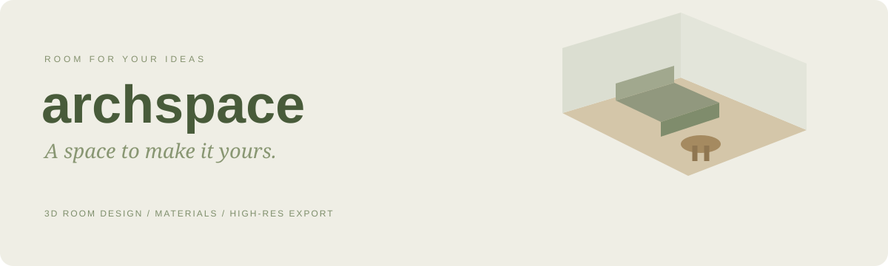
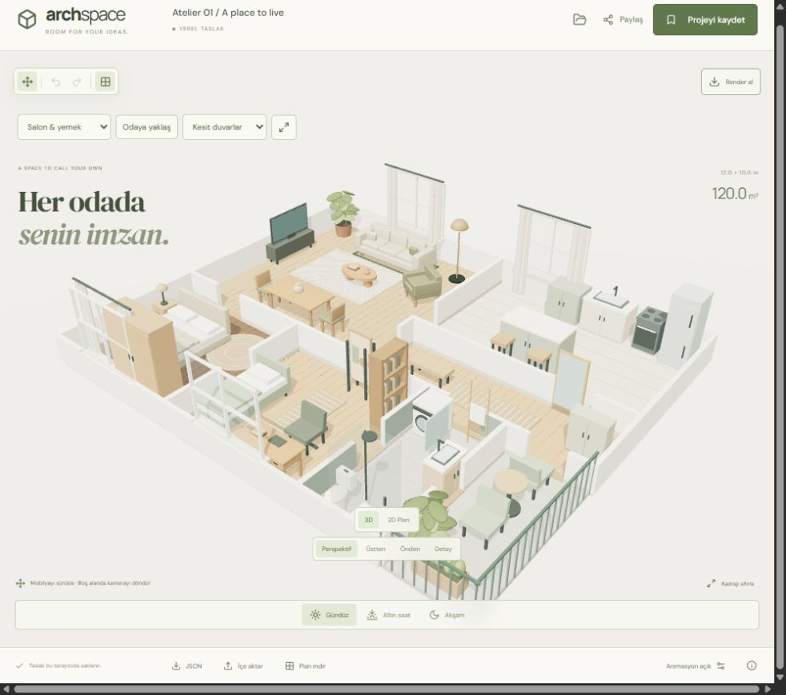
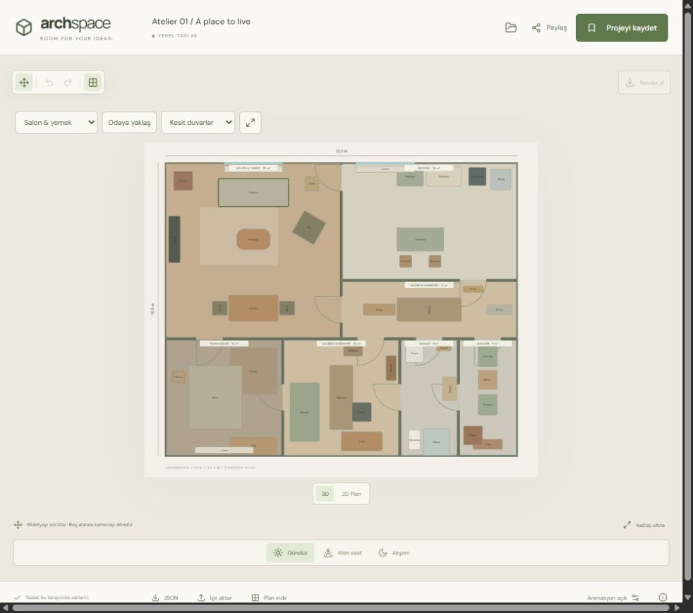

# ARCHSPACE

[](https://github.com/berkayozdmr21/archspace/actions/workflows/ci.yml)

**React 19 · Three.js · React Three Fiber · GSAP · FastAPI · SQLite**



**Seven spaces. One home. Make every room your own.**

A full-stack 3D home design studio: a complete 120 m² apartment with a balcony, 44 original furniture and accessory models, editable floor plans, room-specific finishes, cinematic camera transitions and high-resolution PNG exports.

Developed by **Berkay Özdemir** · [GitHub](https://github.com/berkayozdmr21)

## Studio preview



Actual browser capture of the included editor.



## Design your space

- **A complete home:** living/dining room, kitchen, entrance/hallway, bedroom, study/guest room, bathroom and balcony.
- **44 original pieces:** furniture, linen curtains, rectangular/round rugs, runners, wardrobes, kitchen modules and appliances, bathroom fixtures, terrace seating, lamps, mirrors and decorative objects.
- **45-piece furnished starting scene** with windows, skirting, doorway openings, kitchen worktops, shower glass and balcony railings.
- Whole-house or room-focus cameras, perspective/top views, editable 2D plan and an expanded workspace that hides side panels.
- Cutaway, full-height or low walls; top-view cameras automatically lower walls for visibility.
- Select furniture in the scene, drag it across the floor, rotate, scale, recolor, duplicate or delete it.
- Room-aware placement with rotated footprint bounds, optional 25 cm snapping and furniture-overlap warnings.
- Undo/redo with one history entry per completed drag; keyboard shortcuts for common actions.
- A fixed 12 × 10 m home layout with adjustable ceiling height. Choose wall colors and floor materials separately for each room; the structural layout is not a wall-drawing CAD editor.
- Four floor finishes, wood-plank/tile details, room wall palettes and day/golden-hour/evening lighting.
- Perspective, top, front and selected-object cameras with smooth transitions.
- Three starting layouts: **Nordic**, **Japandi** and **Gallery**.

## More than a 3D preview

- An editable 2D floor plan with furniture silhouettes and room dimensions.
- SVG floor-plan export and validated JSON import/export.
- Automatic browser draft persistence.
- Named SQLite project collections and public read-only project links.
- Server-calculated demonstration furniture totals.
- Responsive controls and reduced-motion support.
- Automatic 2D fallback when WebGL 2 is unavailable.

The editor interface is in Turkish; this README documents the project in English.

All furniture and materials are authored procedurally in this repository. No downloaded 3D models, paid APIs or API keys are required. Prices and product names are fictional and do not constitute sales offers. This is a concept-layout tool, not an architectural construction or manufacturing specification.

## PNG render exports

1. Choose a camera angle and lighting atmosphere in **3D** mode.
2. Open **Render al** and select 1920, 2560 or 3840 pixels wide.
3. Optionally enable **Şeffaf stüdyo arka planı**.
4. Generate the render, inspect the preview and choose **PNG dosyasını indir**.

Camera aspect ratio is preserved and a 72-pixel project caption is appended. Selection outlines are hidden during rendering. The transparency option removes the studio outside the room, while preserving the room floor and walls. GPU texture limits are checked and renderer/scene settings are restored afterward.

Exports are static real-time WebGL images, not offline path-traced renders or interactive 3D files. For a vector plan, switch to **2D Plan** and choose **Plan indir**.

## Start on Windows

1. Install Python 3.10 or newer.
2. Download this repository using **Code → Download ZIP** and extract it, or clone it with `git clone https://github.com/berkayozdmr21/archspace.git`.
3. Double-click **BASLAT.cmd**.
4. Keep the terminal open while using the studio.

The first launch installs Python dependencies into the project `.venv` and requires internet. A production frontend is included, so Node.js is not required for normal use. The launcher prefers port **8980**, selects another available port when occupied and opens the browser after the health check succeeds.

## Development

Use Node.js 22 and Python 3.10+.

```powershell
python -m venv .venv
.venv\Scripts\python -m pip install -r requirements.txt
cd frontend
npm ci
npm run build
cd ..
.venv\Scripts\python run.py
```

For frontend hot reload, start `python -m uvicorn backend.main:app --port 8980`, then run `npm run dev` in `frontend`. Vite proxies `/api` to the backend. Production serves the frontend and API from the same origin.

## Controls

| Action | Control |
| --- | --- |
| Select | Click a furniture model or 2D silhouette |
| Move | Enable the move tool, then drag the selected furniture |
| Orbit camera | Drag empty space in the 3D studio |
| Zoom | Mouse wheel / touch zoom |
| Undo / redo | Ctrl+Z / Ctrl+Shift+Z |
| Rotate selected piece | R |
| Duplicate | Ctrl+D |
| Delete | Delete or Backspace |
| Exact placement | X/Z inputs, rotation and scale sliders |

Object shortcuts are disabled while editing text fields or using dialogs. Enable reduced motion in the footer to remove entrance motion and snap camera/material transitions.

## Architecture

| Layer | Technology |
| --- | --- |
| Interface | React 19, CSS, Lucide icons |
| 3D | Three.js, React Three Fiber, Drei, procedural geometry/textures |
| Motion | GSAP camera/object entrance transitions, frame-driven material and light easing |
| Domain | Validated scene documents, rotated bounds, snapping, history and demo estimates |
| Backend | FastAPI, Pydantic, SQLite |
| Delivery | Vite production build, Windows launcher, Docker, GitHub Actions workflow |

```text
frontend/catalog.json         Furniture dimensions and fictional prices
frontend/src/design.js        Validation, placement, bounds, layouts and totals
frontend/src/Furniture.jsx    Original furniture models and drag interaction
frontend/src/HomeFurniture.jsx Additional kitchen, bathroom, textile and outdoor models
frontend/src/House.jsx        Multi-room architecture, doors, windows and balcony
frontend/home.json           Shared room layout used by frontend and backend
frontend/src/RoomScene.jsx    Lighting, camera and PNG rendering
frontend/src/FloorPlan.jsx    Editable 2D SVG plan
frontend/src/main.jsx         Editor, history, collections and import/export UI
backend/main.py              Server validation, estimates and project persistence
tests/test_api.py            Backend integration tests
```

## Persistence and sharing

Drafts are saved in browser local storage. An existing single-room draft is upgraded into the living area of the furnished home; its original JSON is retained under `archspace-legacy-backup`. Existing saved single-room projects remain readable and open as editable home copies; their original saved records are not overwritten. Named projects live in `data/projects.sqlite3`; use `ARCHSPACE_DATA_DIR` to move the data directory.

The HttpOnly, SameSite cookie is an anonymous collection ownership token, not a login system. Clearing it loses collection access. Anyone possessing a project link can read its saved scene. Later edits do not mutate the saved record; sharing a changed design creates a new snapshot. Deleting a project invalidates its share link. Each session may save up to 100 projects, with up to 160 pieces per home (40 in legacy single-room scenes).

Localhost links only work on the hosting computer while the app runs. Remote hosting requires HTTPS, persistent storage, backups and appropriate abuse controls. Personal room plans should not contain sensitive information when shared publicly.

## API

Open `/docs` for interactive documentation.

| Method | Endpoint | Purpose |
| --- | --- | --- |
| GET | `/api/health` | Readiness |
| GET | `/api/catalog` | Furniture metadata |
| GET | `/api/session` | Anonymous ownership session |
| POST | `/api/estimate` | Validate a scene and calculate its demo total |
| GET / POST | `/api/projects` | List owned projects / save a project |
| GET | `/api/projects/{id}` | Read a shared snapshot |
| DELETE | `/api/projects/{id}` | Delete an owned project |

Writes require `X-Archspace-Client: archspace`, and cross-origin writes are blocked. The backend rejects unknown fields, invalid colors/types/scales, duplicate object IDs, oversized scenes and furniture outside the room, including rotated footprints. Furniture cannot straddle internal room boundaries in home scenes. Furniture overlaps are allowed for creative control and flagged by the UI; they are not automatically resolved by a physics engine.

## Checks

```sh
python -m unittest discover -s tests -v
cd frontend
npm test -- --run
npm run build
```

**49 automated tests:** 23 backend integration tests and 26 frontend/domain tests. See [VERIFICATION.md](VERIFICATION.md) for browser checks and limits.

## Docker

```sh
docker compose up --build
```

Open `http://127.0.0.1:8980`. SQLite persists in the `project-data` volume. Docker execution has not been verified in the delivery environment.

## Assets and dependencies

Furniture, product thumbnails, house geometry, floor details and banner artwork are original code-generated assets. Third-party packages retain their respective licenses. Google Fonts requests are optional, with system-font fallbacks. No external 3D asset service is required.
